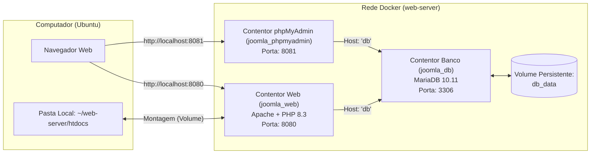

# 🚀 Guia Completo: Ambiente Docker para Joomla no Ubuntu

Este guia documenta todo o processo de criação, configuração, migração e manutenção de um ambiente local para desenvolvimento em **Joomla** utilizando **Docker** e **Docker Compose**, substituindo a clássica dependência do XAMPP/LAMPP.

---

## 📑 Índice
1. [Visão Geral da Arquitetura](#1-visão-geral-da-arquitetura)
2. [Instalação Inicial do Docker no Ubuntu](#2-instalação-inicial-do-docker-no-ubuntu)
3. [Estrutura de Ficheiros e Configurações](#3-estrutura-de-ficheiros-e-configurações)
4. [Migração e Ligação do Site Joomla](#4-migração-e-ligação-do-site-joomla)
5. [Comandos para o Dia a Dia](#5-comandos-para-o-dia-a-dia)
6. [Rotinas de Cópia de Segurança (Backup & Restauro)](#6-rotinas-de-cópia-de-segurança-backup--restauro)
7. [Manutenção, Atualizações e Resolução de Problemas](#7-manutenção-atualizações-e-resolução-de-problemas)

---

## 1. Visão Geral da Arquitetura

Em vez de instalar pacotes de forma monolítica no sistema operativo (como fazia o XAMPP), o Docker isola cada serviço em contentores dedicados que comunicam entre si através de uma rede interna virtual:



### Correspondência com o antigo fluxo do XAMPP:
| Função | No antigo XAMPP | No novo Ambiente Docker |
| :--- | :--- | :--- |
| **Onde colocar o site** | `/opt/lampp/htdocs/` | `~/web-server/htdocs/` |
| **Iniciar serviços** | `sudo /opt/lampp/lampp start` | `docker compose up -d` |
| **Parar serviços** | `sudo /opt/lampp/lampp stop` | `docker compose down` |
| **URL do site** | `http://localhost/` | `http://localhost:8080/` |
| **Interface do Banco** | `http://localhost/phpmyadmin` | `http://localhost:8081/` |
| **Host da Base de Dados** | `localhost` | **`db`** |

---

## 2. Instalação Inicial do Docker no Ubuntu

Se precisar de configurar uma nova máquina Ubuntu (24.04 LTS ou superior), estes são os comandos necessários para instalar o Docker Engine e o plugin Compose:

```bash
# 1. Atualizar repositórios e instalar certificados
sudo apt update
sudo apt install -y ca-certificates curl gnupg

# 2. Adicionar a chave GPG oficial do Docker
sudo install -m 0755 -d /etc/apt/keyrings
curl -fsSL https://download.docker.com/linux/ubuntu/gpg | sudo gpg --dearmor -o /etc/apt/keyrings/docker.gpg
sudo chmod a+r /etc/apt/keyrings/docker.gpg

# 3. Adicionar o repositório oficial
echo \
  "deb [arch=$(dpkg --print-architecture) signed-by=/etc/apt/keyrings/docker.gpg] https://download.docker.com/linux/ubuntu \
  $(. /etc/os-release && echo "$VERSION_CODENAME") stable" | \
  sudo tee /etc/apt/sources.list.d/docker.list > /dev/null

# 4. Instalar o Docker Engine e Docker Compose
sudo apt update
sudo apt install -y docker-ce docker-ce-cli containerd.io docker-buildx-plugin docker-compose-plugin

# 5. Adicionar o utilizador atual ao grupo docker (evita usar sudo sempre)
sudo usermod -aG docker $USER
```

> [!IMPORTANT]
> Após o comando `usermod`, termine a sessão e entre novamente (ou corra `newgrp docker`) para recarregar o grupo no terminal ativo.

---

## 3. Estrutura de Ficheiros e Configurações

A raiz do projeto fica em `~/web-server/`. A estrutura física de pastas é a seguinte:

```text
~/web-server/
├── Dockerfile              # Receita da imagem PHP com extensões do Joomla
├── docker-compose.yml      # Definição e orquestração dos serviços
└── htdocs/                 # Pasta com os ficheiros do site Joomla
```

### 3.1. Ficheiro `Dockerfile`
O Joomla necessita de módulos PHP que não vêm ativados por defeito na imagem padrão do PHP. Este ficheiro garante que o Apache e o PHP suportam o Joomla perfeitamente:

```dockerfile
FROM php:8.3-apache

# Habilitar o mod_rewrite do Apache (essencial para URLs amigáveis / SEO do Joomla)
RUN a2enmod rewrite

# Instalar dependências do Linux e extensões PHP requeridas pelo Joomla
RUN apt-get update && apt-get install -y \
    libpng-dev \
    libjpeg-dev \
    libfreetype6-dev \
    libzip-dev \
    libicu-dev \
    unzip \
    && docker-php-ext-configure gd --with-freetype --with-jpeg \
    && docker-php-ext-install -j$(nproc) \
        gd \
        mysqli \
        pdo_mysql \
        zip \
        intl \
        opcache \
    && rm -rf /var/lib/apt/lists/*

# Configurações recomendadas de memória e upload para o Joomla
RUN echo "memory_limit = 512M" > /usr/local/etc/php/conf.d/joomla.ini \
    && echo "upload_max_filesize = 64M" >> /usr/local/etc/php/conf.d/joomla.ini \
    && echo "post_max_size = 64M" >> /usr/local/etc/php/conf.d/joomla.ini \
    && echo "max_execution_time = 300" >> /usr/local/etc/php/conf.d/joomla.ini
```

### 3.2. Ficheiro `docker-compose.yml`

```yaml
services:
  # Servidor Web + PHP (equivalente ao Apache do XAMPP)
  web:
    build: .
    container_name: joomla_web
    restart: always
    ports:
      - "8080:80"
    volumes:
      - ./htdocs:/var/www/html
    environment:
      - APACHE_DOCUMENT_ROOT=/var/www/html

  # Base de Dados (equivalente ao MySQL do XAMPP)
  db:
    image: mariadb:10.11
    container_name: joomla_db
    restart: always
    environment:
      MYSQL_ROOT_PASSWORD: rootpassword
      MYSQL_DATABASE: joomla_db
      MYSQL_USER: joomla_user
      MYSQL_PASSWORD: joomlapassword
    volumes:
      - db_data:/var/lib/mysql
    ports:
      - "3306:3306"

  # phpMyAdmin (interface gráfica para bases de dados)
  phpmyadmin:
    image: phpmyadmin:latest
    container_name: joomla_phpmyadmin
    restart: always
    ports:
      - "8081:80"
    environment:
      PMA_HOST: db
      UPLOAD_LIMIT: 64M

volumes:
  db_data:
```

---

## 4. Migração e Ligação do Site Joomla

### Passo A: Colocar os ficheiros na pasta `htdocs`
Copie todos os ficheiros do seu site Joomla (pastas `administrator`, `components`, `modules`, etc.) diretamente para:
```text
~/web-server/htdocs/
```

### Passo B: Ajustar permissões no Linux
No Linux, o Apache corre com o utilizador `www-data`. Para que o Joomla consiga gravar cache, instalar extensões e guardar uploads sem erros:
```bash
sudo chown -R www-data:www-data ~/web-server/htdocs
```

### Passo C: Importar a Base de Dados

Existem duas formas de importar o seu ficheiro de base de dados para o MariaDB do Docker:

#### Método 1: Direto pelo Terminal (Mais rápido, sem limites e recomendado para ficheiros grandes)
Se a sua base de dados foi descarregada no Windows (por exemplo, na pasta Transferências/Downloads) ou tiver mais de 50 MB (ou formato `.sql.gz`), este é o método ideal, pois contorna todas as restrições de upload e *timeouts* do navegador.

O WSL acede diretamente a todos os discos e ficheiros do Windows através do caminho `/mnt/c/Users/<Utilizador>/`:

* **Se o ficheiro estiver compactado em `.sql.gz`:**
  ```bash
  cd ~/web-server
  zcat /mnt/c/Users/Lenovo/Downloads/nome_do_ficheiro.sql.gz | docker compose exec -T db mariadb -u root -prootpassword joomla_db
  ```
  *(O utilitário `zcat` lê e descompacta o ficheiro diretamente em memória para o MariaDB em apenas 10-20 segundos).*

* **Se o ficheiro for um `.sql` normal descompactado:**
  ```bash
  cd ~/web-server
  docker compose exec -T db mariadb -u root -prootpassword joomla_db < /mnt/c/Users/Lenovo/Downloads/nome_do_ficheiro.sql
  ```

#### Método 2: Pela Interface Web do phpMyAdmin (Para ficheiros pequenos < 64MB)
1. Aceda no navegador a: **`http://localhost:8081`**
2. Inicie sessão com:
   * **Utilizador:** `root`
   * **Palavra-passe:** `rootpassword`
3. No menu lateral esquerdo, clique no nome da base de dados **`joomla_db`**.
4. No menu superior, clique em **Importar** (*Import*).
5. Clique em **Escolher ficheiro** (*Browse*).
   > [!TIP]
   > **Como aceder aos ficheiros do Ubuntu a partir do seletor do Windows:**
   > Como o navegador está a correr no Windows, a janela abrirá as pastas do Windows. Se o ficheiro estiver guardado dentro do Ubuntu (WSL):
   > * Clique no ícone do pinguim **Linux** na barra lateral esquerda do Explorador de Ficheiros do Windows;
   > * Ou cole na barra de endereços do Explorador: `\\wsl.localhost\Ubuntu\home\dbotas\`
6. Clique em **Executar** (*Go*).

### Passo D: Atualizar o ficheiro `configuration.php` do Joomla
Abra o ficheiro `~/web-server/htdocs/configuration.php` e certifique-se de que os seguintes parâmetros correspondem ao ambiente Docker:

```php
    /* Ligação à Base de Dados */
    public $host = 'db';                 // ATENÇÃO: Tem de ser 'db', NUNCA 'localhost'
    public $user = 'root';               // ou 'joomla_user'
    public $password = 'rootpassword';   // ou 'joomlapassword'
    public $db = 'joomla_db';

    /* Caminhos Absolutos no Sistema Linux do Contentor */
    public $log_path = '/var/www/html/administrator/logs';
    public $tmp_path = '/var/www/html/tmp';
```

---

## 5. Comandos para o Dia a Dia

Todos os comandos devem ser executados a partir da pasta do projeto (`cd ~/web-server`):

### Iniciar o ambiente (equivalente a `lampp start`):
```bash
docker compose up -d
```
*O parâmetro `-d` (detached) liberta o terminal para continuar a usá-lo.*

### Parar o ambiente (equivalente a `lampp stop`):
```bash
docker compose down
```
*(Não se preocupe: a base de dados e os ficheiros ficam preservados intactos no seu disco).*

### Ver o estado dos contentores em execução:
```bash
docker compose ps
```

### Ver registos de erro em tempo real (Logs do Apache/PHP):
```bash
docker compose logs -f web
```
*(Prima `Ctrl + C` para sair).*

### Abrir o terminal dentro do contentor web:
Se precisar de correr comandos PHP CLI, Composer ou Joomla CLI:
```bash
docker compose exec web bash
```
*(Digite `exit` para regressar ao Ubuntu).*

---

## 6. Rotinas de Cópia de Segurança (Backup & Restauro)

### 6.1. Fazer Backup da Base de Dados via Terminal
Para criar um ficheiro SQL completo rapidamente:
```bash
cd ~/web-server
docker compose exec db mariadb-dump -u root -prootpassword joomla_db > backup_joomla_$(date +%F).sql
```

### 6.2. Restaurar um Backup SQL via Terminal
Se quiser repor uma base de dados anterior:
```bash
cd ~/web-server
docker compose exec -T db mariadb -u root -prootpassword joomla_db < meu_backup.sql
```

### 6.3. Backup Completo dos Ficheiros
Basta compactar a sua pasta `htdocs`:
```bash
tar -czvf backup_htdocs_$(date +%F).tar.gz ~/web-server/htdocs
```

---

## 7. Manutenção, Atualizações e Resolução de Problemas

### 7.1. Como atualizar as imagens de base (MariaDB e phpMyAdmin)
Periodicamente, é boa prática descarregar as versões mais recentes das imagens oficiais:
```bash
cd ~/web-server
docker compose pull
docker compose up -d
```

### 7.2. Como aplicar alterações ao `Dockerfile`
Se editar o `Dockerfile` (para instalar mais alguma extensão PHP, por exemplo), precisa de mandar o Docker reconstruir a imagem:
```bash
cd ~/web-server
docker compose up -d --build
```

### 7.3. Atualizar o Joomla e Extensões
* As atualizações de versão do Joomla (ex: Joomla 5.x para versões seguintes) e das extensões/plugins são feitas **diretamente pelo painel administrativo do Joomla** (`http://localhost:8080/administrator`), tal como num servidor web real.
* Recomenda-se sempre fazer um backup rápido da base de dados antes de aplicar grandes atualizações.

### 7.4. Resolução de Problemas Frequentes

#### Erro "403 Forbidden" ao abrir `http://localhost:8080`
* **Cenário 1 (Pasta vazia):** A pasta `htdocs` está vazia ou não contém um ficheiro `index.php` ou `index.html`. O Apache desativa a listagem de diretórios por segurança.
  * **Solução:** Coloque os ficheiros do site (ou um `index.php`) dentro de `~/web-server/htdocs/`.
* **Cenário 2 (Pasta `htdocs` substituída/recriada enquanto o Docker estava ligado):** Se apagou, renomeou ou moveu uma nova pasta `htdocs` inteira no Linux enquanto o contentor estava a correr, a montagem do Docker (*bind mount*) fica presa ao identificador de disco (*inode*) antigo que foi removido. Para o Apache, a pasta continua a parecer vazia mesmo que você veja os ficheiros no Ubuntu.
  * **Solução:** Reinicie o contentor web para forçar o Docker a ligar-se à nova pasta:
    ```bash
    docker compose restart web
    # ou diretamente:
    docker restart joomla_web
    ```

#### Sites colocados em subpastas (ex: `htdocs/iqc/`)
Se tiver vários sites ou colocar o Joomla dentro de uma subpasta como `htdocs/iqc/`:
* O site fica acessível em: `http://localhost:8080/iqc/`
* O painel administrativo fica em: `http://localhost:8080/iqc/administrator/`
* **Importante:** No `configuration.php`, os caminhos de log e tmp devem incluir o nome da subpasta:
  ```php
  public $log_path = '/var/www/html/iqc/administrator/logs';
  public $tmp_path = '/var/www/html/iqc/tmp';
  ```

#### Erro "Error connecting to the database"
* **Causa:** O ficheiro `configuration.php` está com `public $host = 'localhost';` ou credenciais erradas.
* **Solução:** Altere para `public $host = 'db';` (o nome do serviço na rede Docker) e confirme o utilizador (`root` ou `joomla_user`) e senha (`rootpassword` ou `joomlapassword`).

#### Erro "File exceeds upload_max_filesize" ou Timeout no phpMyAdmin
* **Causa:** O phpMyAdmin tem um limite predefinido de 64 MB para upload através do navegador. Ficheiros grandes de bancos de dados geram erro ou excedem o tempo limite.
* **Solução:** Utilize o método de importação direta pelo terminal com `zcat` (ver Secção 4 - Passo C, Método 1). Além de não ter limite de tamanho, importa em segundos.

#### Erro de permissões ao enviar fotos ou instalar extensões no Joomla
* **Causa:** Os ficheiros foram criados pelo seu utilizador do Linux sem permissão de escrita para o Apache (`www-data`).
* **Solução:** Corra no terminal:
  ```bash
  sudo chown -R www-data:www-data ~/web-server/htdocs
  ```

#### Janela do terminal bloqueada com aviso `[WARN: COPY MODE]` no tmux
* **Causa:** No tmux, ao usar o scroll do rato ou selecionar texto, o tmux entra no modo de cópia e pausa os processos no ecrã.
* **Solução:** Pressione a tecla **`q`** (ou **`Ctrl + c`**) para sair imediatamente do modo de cópia e desbloquear o terminal.

#### Como aceder a partir do Windows (Ambiente WSL2)
* O WSL2 e o Windows partilham a interface de rede local (`localhost`).
* **Recomendação:** Abra o seu navegador diretamente no Windows (Edge, Chrome, Brave, etc.) e aceda a `http://localhost:8080`. Não é necessário instalar ou rodar navegadores com interface gráfica pesada dentro do Linux no WSL.

#### Limpeza total de ficheiros temporários do Docker
Se ao longo dos meses o Docker acumular imagens antigas não utilizadas:
```bash
docker system prune -a
```
*(Nota: Isto não apaga a sua base de dados `db_data` nem os seus ficheiros `htdocs`)*.
