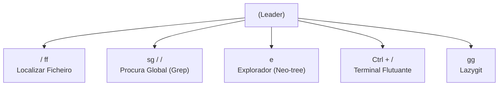

# 🚀 Guia Prático: Neovim + LazyVim como IDE sem Rato

Este guia reúne todas as instruções, configurações e atalhos essenciais para transformar o **Neovim (LazyVim)** no teu ambiente de desenvolvimento principal para **Java (TestNG + Selenide)** e **Python (Pytest)**, com gestão de versões via **Git/Lazygit** sem depender do rato.

---

## 📌 1. Filosofia e Tecla Mestre

* **Tecla Líder (`<leader>`)**: No LazyVim é a **`<Barra de Espaço>`**.
* **Menu de Ajuda Dinâmico (*which-key*)**: Ao carregar em `<Espaço>` e aguardar meio segundo, surge uma janela inferior com todos os atalhos disponíveis organizados por categorias (`f` para ficheiros, `c` para código, `t` para testes, `g` para git, etc.).
* **Regra de Ouro**: Resiste ao rato. A mão direita permanece no teclado de navegação (`h, j, k, l`).

---

## 🛠️ 2. Instalação e Requisitos no Ubuntu

### Dependências de Sistema e Ferramentas CLI
```bash
sudo apt update
sudo apt install -y build-essential ripgrep fd-find unzip curl git openjdk-21-jdk maven python3-venv
```

Cria um alias para o `fd` se necessário:
```bash
mkdir -p ~/.local/bin
ln -s $(which fdfind) ~/.local/bin/fd
```

### Instalação do Neovim (Binário Oficial $\ge$ 0.10)
> [!IMPORTANT]
> O pacote padrão dos repositórios apt do Ubuntu 24.04 é antigo (0.9.5). O LazyVim moderno exige $\ge$ 0.10.

```bash
curl -LO https://github.com/neovim/neovim/releases/latest/download/nvim-linux-x86_64.tar.gz
sudo rm -rf /opt/nvim-linux-x86_64
sudo tar -C /opt -xzf nvim-linux-x86_64.tar.gz
rm nvim-linux-x86_64.tar.gz
sudo ln -sf /opt/nvim-linux-x86_64/bin/nvim /usr/local/bin/nvim
```

### Nerd Font (Ícones do IDE)
Instalar a **JetBrainsMono Nerd Font** para exibir ícones gráficos no terminal:
```bash
mkdir -p ~/.local/share/fonts
curl -fLo ~/.local/share/fonts/JetBrainsMono.tar.xz \
  https://github.com/ryanoasis/nerd-fonts/releases/latest/download/JetBrainsMono.tar.xz
tar -xf ~/.local/share/fonts/JetBrainsMono.tar.xz -C ~/.local/share/fonts/
fc-cache -fv
```
*Configura o teu terminal (Gnome Terminal, Alacritty, Kitty, Ghostty) para usar a fonte "JetBrainsMono Nerd Font".*

---

## 🗂️ 3. Navegação e Gestão de Janelas (Splits & Buffers)



### Ficheiros e Pesquisa
* `<Espaço><Espaço>` ou `<Espaço>ff`: Procura rápida de ficheiro pelo nome (*Fuzzy find*).
* `<Espaço>/` ou `<Espaço>sg`: Pesquisa global de texto em todo o projeto (*Live Grep*).
* `<Espaço>e`: Alterna a barra lateral com a árvore de diretórios (Neo-tree).
  * Dentro da árvore: `a` para criar novo ficheiro/pasta, `d` para apagar, `r` para renomear.

### Gestão de Ecrã e Buffers
* `Shift + h` / `Shift + l`: Alternar entre ficheiros abertos na barra superior (esquerda/direita).
* `<Espaço>bd`: Fechar o buffer (ficheiro) atual.
* `<Espaço>|`: Dividir a janela verticalmente.
* `<Espaço>-`: Dividir a janela horizontalmente.
* `Ctrl + h / j / k / l`: Mover o cursor entre janelas divididas.

---

## 🌿 4. Controlo de Versões com Git & Lazygit

O LazyVim inclui integração profunda com o **Lazygit**:

* **`<Espaço>gg`**: Abre a interface gráfica de terminal do Lazygit.
  * `Espaço`: Faz *stage* / *unstage* de um ficheiro ou bloco de linhas selecionado.
  * `c`: Abre a caixa para escrever a mensagem de commit.
  * `Shift + p` (`P`): Efetua `git push`.
  * `p`: Efetua `git pull`.
  * `r` (no painel de branches): Rebase sobre o ramo selecionado.
  * `q` ou `Esc`: Sai do Lazygit e volta instantaneamente ao código.

### Gestão de Chave SSH & Passphrase
Para evitar que o Git ou Lazygit peçam a senha constantemente:
```bash
eval "$(ssh-agent -s)"
ssh-add ~/.ssh/id_rsa
# ou se usares ed25519:
ssh-add ~/.ssh/id_ed25519
```

> [!TIP]
> **Erro "Permission denied" em ficheiros `.idea` ou repositórios:**
> Se o Git falhar durante rebase/pull com erro de permissões (ficheiros criados por `root`), corrige com:
> ```bash
> sudo chown -R $USER:$USER /caminho/para/o/projeto
> ```

---

## ☕ 5. Testes em Java: TestNG + Selenide

### Configuração no LazyVim
Certifica-te de que os seguintes extras estão ativados em `:LazyExtras`:
* `lang.java`
* `test.core`
* `dap.core`

No `:Mason`, confirma a instalação de:
* `java-debug-adapter`
* `java-test`

### Execução de Testes TestNG
* Posiciona o cursor no método `@Test` e usa:
  * `<Espaço>tr`: Executa o teste mais próximo (*Run Nearest Test*).
  * `<Espaço>tt`: Executa toda a classe de testes (*Run All Tests*).
* **Via Terminal Flutuante (`Ctrl-/`)**:
  ```bash
  mvn test -Dtest=LoginTest
  mvn test -Dtest=LoginTest#testValidCredentials
  ```

### Selenide no Linux
No Linux, o Selenide abrirá a janela do browser normalmente. Para correr em modo silencioso/background:
```java
import com.codeborne.selenide.Configuration;

// No método @BeforeClass ou @BeforeMethod:
Configuration.headless = true;
```

---

## 🐍 6. Testes em Python: Pytest

### Configuração
O LazyVim já inclui `lang.python` com o adaptador `neotest-python` (que usa o `pytest` por padrão).

### Seleção do VirtualEnv (Crítico!)
* Prime **`<Espaço>cv`** (*Code $\rightarrow$ Select VirtualEnv*).
* Escolhe a pasta `.venv` ou o ambiente Poetry/Conda correspondente ao teu projeto para que o LSP e o Pytest usem os pacotes corretos.

### Atalhos Neotest para Pytest
| Atalho | Ação |
| :--- | :--- |
| `<Espaço>tr` | Executa o ficheiro de teste atual (*Run File*). |
| `<Espaço>tt` | Executa o teste/função sob o cursor (*Run Nearest*). |
| `<Espaço>ts` | Abre o painel lateral com a árvore e sumário dos testes (*Toggle Summary*). |
| `<Espaço>to` | Abre a janela flutuante com a mensagem de erro/traceback (*Test Output*). |
| `<Espaço>tO` | Abre o painel inferior com o log completo da consola. |
| `<Espaço>tw` | **Modo Watch**: corre os testes automaticamente sempre que gravas (`:w`). |
| `<Espaço>dPt`| Inicia o teste em modo depuração com *breakpoints* (*Debug Python Test*). |

---

## ⚡ 7. Tabela de Consulta Rápida (Cheat Sheet)

```
┌──────────────────────────────────────────────────────────────┐
│                    NAVEGAÇÃO & GERAL                         │
├──────────────────────────────┬───────────────────────────────┤
│ <Espaço><Espaço>             │ Encontrar ficheiro            │
│ <Espaço>sg                   │ Pesquisar texto em ficheiros  │
│ <Espaço>e                    │ Explorador de pastas/ficheiros│
│ Shift + h / Shift + l        │ Alternar abas/buffers         │
│ Ctrl + /                     │ Abrir/fechar terminal rápido  │
├──────────────────────────────┼───────────────────────────────┤
│                        CÓDIGO (LSP)                          │
├──────────────────────────────┬───────────────────────────────┤
│ gd                           │ Ir para a definição           │
│ K                            │ Ver documentação / tooltip    │
│ <Espaço>ca                   │ Ações de código / Auto-import │
│ <Espaço>cr                   │ Renomear variável / símbolo   │
│ <Espaço>cf                   │ Formatar código               │
├──────────────────────────────┼───────────────────────────────┤
│                           TESTES                             │
├──────────────────────────────┬───────────────────────────────┤
│ <Espaço>tr                   │ Executar ficheiro de testes   │
│ <Espaço>tt                   │ Executar teste mais próximo   │
│ <Espaço>ts                   │ Abrir sumário de testes       │
│ <Espaço>to                   │ Ver erro / traceback do teste │
│ <Espaço>tw                   │ Modo Watch (auto-run ao salvar│
├──────────────────────────────┼───────────────────────────────┤
│                            GIT                               │
├──────────────────────────────┬───────────────────────────────┤
│ <Espaço>gg                   │ Abrir Lazygit                 │
│ <Espaço>gb                   │ Ver Git Blame da linha atual  │
│ [h  /  ]h                    │ Saltar para diff anterior/seg.│
└──────────────────────────────┴───────────────────────────────┘
```
