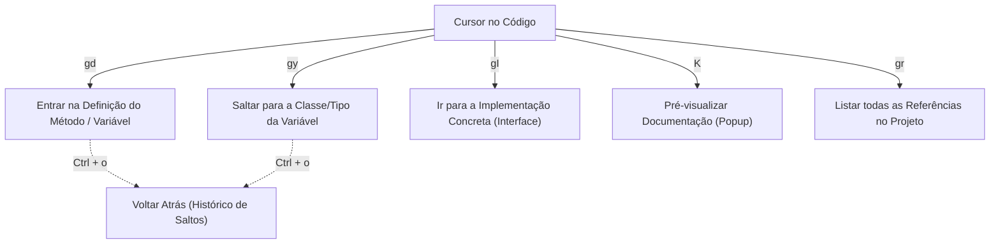

# 🚀 Guia Mestre: Neovim + LazyVim como IDE para Automação de Testes (Java & Python) e Git

Este é o teu manual de referência completo e centralizado para utilizar o **Neovim (LazyVim)** como ambiente de desenvolvimento de excelência para testes automatizados (**Java com TestNG + Selenide** e **Python com Pytest**), com gestão de versões via **Git/Lazygit** sem depender do rato.

---

## 📌 1. Filosofia de Utilização e Tecla Mestre

* **Tecla Líder (`<leader>`)**: No LazyVim é a **`<Barra de Espaço>`**.
* **Menu Dinâmico (*which-key*)**:
  * Ao carregar numa tecla introdutória (como `<Espaço>` ou `g`), abre-se uma janela inferior com as opções.
  * **Como funciona:** Não se navega com setas nem com `Enter`. Carrega-se **diretamente na letra da opção desejada**.
  * **Mudar de página:** Se houver várias páginas de atalhos, usa **`<Ctrl-d>`** (descer) e **`<Ctrl-u>`** (subir).
  * **Cancelar/Sair:** Prime **`<Esc>`**.
* **Regra de Ouro:** Evitar o rato. Toda a navegação é feita pelo teclado com `h, j, k, l`, `w, b` e saltos inteligentes.

---

## 🛠️ 2. Instalação e Requisitos no Ubuntu

### Ferramentas de Sistema e Compiladores
```bash
sudo apt update
sudo apt install -y build-essential ripgrep fd-find unzip curl git maven python3-venv
```

Criar o alias para o comando `fd`:
```bash
mkdir -p ~/.local/bin
ln -s $(which fdfind) ~/.local/bin/fd
```

### Versões do Java (JDTLS & OpenJDK)
> [!IMPORTANT]
> O servidor de linguagem Java do Mason (`jdtls`) mais recente exige o **Java 25** para executar o seu contentor OSGi/Eclipse sem erros de arranque (*Exit code 13*):

```bash
# Instalar o OpenJDK 25 (retrocompatível com projetos Java 17 e 21)
sudo apt update
sudo apt install -y openjdk-25-jdk
```

### Neovim Oficial ($\ge 0.10$)
```bash
curl -LO https://github.com/neovim/neovim/releases/latest/download/nvim-linux-x86_64.tar.gz
sudo rm -rf /opt/nvim-linux-x86_64
sudo tar -C /opt -xzf nvim-linux-x86_64.tar.gz
rm nvim-linux-x86_64.tar.gz
sudo ln -sf /opt/nvim-linux-x86_64/bin/nvim /usr/local/bin/nvim
```

### Nerd Font (Ícones de Pastas e Ficheiros)
```bash
mkdir -p ~/.local/share/fonts
curl -fLo ~/.local/share/fonts/JetBrainsMono.tar.xz \
  https://github.com/ryanoasis/nerd-fonts/releases/latest/download/JetBrainsMono.tar.xz
tar -xf ~/.local/share/fonts/JetBrainsMono.tar.xz -C ~/.local/share/fonts/
fc-cache -fv
```
*Configura o teu terminal (Gnome Terminal, Kitty, Ghostty, Alacritty) para usar a fonte "JetBrainsMono Nerd Font".*

---

## 🗂️ 3. Navegação, Pesquisa e Janelas

### Pesquisa no Modo Normal (Dentro do Ficheiro)
* **`/palavra` + `<Enter>`**: Procura do cursor para a **frente**.
* **`?palavra` + `<Enter>`**: Procura do cursor para **trás**.
* **`n`**: Salta para a ocorrência **seguinte**.
* **`N`**: Salta para a ocorrência **anterior**.
* **`*`** (Shift + 8): Procura instantânea da palavra exata sob o cursor para a frente (sem escrever).
* **`#`**: Procura instantânea da palavra sob o cursor para trás.
* **`<Esc>`** (ou `:noh`): Limpa o realce amarelo da pesquisa.
* **`<Espaço>s/`** (ou `<Espaço>sb`): Pesquisa interativa por linhas no ficheiro atual via Snacks.

### Ficheiros e Pesquisa Global no Projeto
* `<Espaço><Espaço>` ou `<Espaço>ff`: Localizar ficheiro por nome (*Fuzzy finder*).
* `<Espaço>/` ou `<Espaço>sg`: Pesquisar texto em todos os ficheiros do projeto (*Live Grep*).
* `<Espaço>e`: Alternar a barra lateral com a árvore de diretórios (Neo-tree).
  * Dentro da árvore: `a` cria ficheiro/pasta, `d` apaga, `r` renomeia.

### Janelas (Splits) e Abas (Buffers)
* `Shift + h` / `Shift + l`: Alternar entre ficheiros abertos na barra superior (esquerda/direita).
* `<Espaço>bd`: Fechar o buffer (ficheiro) atual.
* `<Espaço>|`: Dividir o ecrã na vertical.
* `<Espaço>-`: Dividir o ecrã na horizontal.
* `Ctrl + h / j / k / l`: Mover o cursor entre janelas divididas.

---

## ✂️ 4. Edição, Área de Transferência e Rejeição de Alterações

### 1. Colar no Modo Insert (Escrevendo)
* **`Ctrl + r` seguido de `"`**: Cola o texto copiado/cortado dentro do Neovim.
* **`Ctrl + r` seguido de `+`**: Cola o conteúdo da área de transferência do sistema (browser, Slack, etc.).
* **`Ctrl + Shift + v`**: Atalho universal do terminal para colar do sistema operativo.

### 2. O Superpoder do Modo Insert: `Ctrl + o`
Permite executar **um comando do modo Normal** e voltar imediatamente ao modo de escrita sem sair do fluxo:
* **`Ctrl + o` depois `p`**: Cola a seguir ao cursor e continua logo a escrever.
* **`Ctrl + o` depois `yy`**: Copia a linha atual sem sair do modo Insert.
* **`Ctrl + o` depois `dd`**: Corta a linha atual sem sair do modo Insert.

### 3. Cortar Texto Rápido enquanto Escreves
* **`Ctrl + w`**: Corta a **palavra anterior** ao cursor *(ideal para corrigir gralhas imediatamente)*.
* **`Ctrl + u`**: Corta do cursor até ao **início da linha**.

### 4. Modo Normal (`Esc`): Copiar, Cortar e Colar
* **`yy`**: Copia a linha inteira.
* **`dd`**: Corta a linha inteira.
* **`yiw`** (*Yank Inside Word*): Copia a palavra onde está o cursor.
* **`diw`** (*Delete Inside Word*): Corta a palavra onde está o cursor.
* **`p` / `P`**: Cola a seguir / antes do cursor.

### 5. Como Rejeitar Alterações / Descartar Escrita
* **`u`** (*Undo*): Desfaz a última alteração (carrega várias vezes para retroceder no tempo).
* **`Ctrl + r`** (*Redo*): Refaz a alteração desfeita.
* **`:e!`** (*Edit reload*): **Descarta todas as alterações não guardadas** e recarrega o ficheiro tal como está no disco.
* **`:q!`** (*Quit force*): Fecha o ficheiro imediatamente sem guardar nada.
* **`<Espaço>ghR`** (*Git Reset Buffer*): Reverte todo o ficheiro para a versão limpa do Git (mesmo que já tenhas gravado com `:w`).

---

## 🔍 5. Navegação no Código com LSP (Variáveis, Métodos e Classes)

> [!NOTE]
> Os atalhos iniciados por `g` só aparecem e ficam ativos se o servidor de linguagem estiver conectado ao ficheiro. Abre sempre o Neovim **na pasta raiz do projeto** (onde está o `pom.xml`, `build.gradle` ou `.git`) e verifica com `:LspInfo`.



### Atalhos de Salto
* **`gd`** (*Go to Definition*): Salta diretamente para o código onde o método sob o cursor foi implementado.
* **`gy`** (*Go to Type Definition*): Estando sobre uma variável (ex: `loginPage`), salta diretamente para o ficheiro da **Classe dessa variável** (`LoginPage.java`).
* **`gI`** (*Go to Implementation*): Salta para a implementação concreta quando se trata de um método de interface.
* **`K`** (Shift + k): Abre um balão flutuante com a assinatura, parâmetros e JavaDoc/Docstring sem mudar de ficheiro.
* **`gr`**: Lista todas as referências no projeto onde esse método/variável é utilizado.

### Como Voltar Atrás (Histórico de Saltos)
* **`Ctrl + o`**: Volta para a posição anterior de onde fizeste o salto (*Jump list back*).
* **`Ctrl + i`**: Avança novamente para a frente (*Jump list forward*).

---

## ☕ 6. Testes e Código em Java (TestNG + Selenide)

### Configuração de Módulos
* Em `:LazyExtras`: `lang.java`, `test.core` e `dap.core`.
* Em `:Mason`: `java-debug-adapter` e `java-test`.

### Formatação e Limpeza de Código Java
* **`<Espaço>cf`** (*Code Format*): Formata o ficheiro Java atual (ou apenas as linhas selecionadas em modo visual).
* **`<Espaço>co`** (*Organize Imports*): Remove imports Java não utilizados e organiza os restantes alfabeticamente.
* **`<Espaço>uf`**: Liga/desliga a auto-formatação ao gravar para o ficheiro atual.

### Atalhos de Execução no `keymaps.lua`
Configurados em `~/.config/nvim/lua/config/keymaps.lua` com `{ auto_close = false }` (a janela **mantém-se aberta** para leitura dos resultados):

| Atalho | O que executa | Como funciona |
| :--- | :--- | :--- |
| **`<Espaço>tm`** | **Método `@Test` sob o cursor** | Deteta o método atual via Treesitter e corre: `mvn test -Dtest=Classe#metodo`. |
| **`<Espaço>tc`** | **Classe de teste inteira** | Corre `mvn test -Dtest=Classe` via Maven. |
| **`<Espaço>tx`** | **Ficheiro Suite XML atual** | Estando num `.xml` (ex: `testng.xml`), corre: `mvn clean test -DsuiteXmlFile=ficheiro.xml`. |
| **`<Espaço>tr`** | **Método nativo (DAP)** | Execução interna do JDTLS sem abrir terminal externo. |
| **`<Ctrl-/>`** | **Alternar Terminal de Logs** | Abre ou recolhe a janela flutuante com o log completo. |

### Visualização de Output e Logs dos Testes
1. O terminal não fecha sozinho. Mantém-se visível no ecrã com o relatório de execução do Maven, TestNG e Selenide.
2. **Navegar no log:** Usa **`Ctrl + u`** (subir) e **`Ctrl + d`** (descer), ou `j`/`k`.
3. **Pesquisar erros:** Digita `/FAILURE` ou `/Exception` e carrega em `Enter`.
4. **Fechar a janela:** Prime **`q`** ou **`<Ctrl-/>`**.
5. **Reabrir histórico:** Prime **`<Ctrl-/>`** a qualquer altura.

### Suporte a XML no `pom.xml`
```xml
<plugin>
    <groupId>org.apache.maven.plugins</groupId>
    <artifactId>maven-surefire-plugin</artifactId>
    <version>3.2.5</version>
    <configuration>
        <suiteXmlFiles>
            <suiteXmlFile>${suiteXmlFile}</suiteXmlFile>
        </suiteXmlFiles>
    </configuration>
</plugin>
```

### Selenide no Linux
```java
import com.codeborne.selenide.Configuration;

Configuration.headless = true; // corre sem abrir janelas visuais
```

---

## 🐍 7. Testes em Python: Pytest

### Configuração
O LazyVim inclui `lang.python` com o adaptador `neotest-python`.

### Seleção de VirtualEnv
* **`<Espaço>cv`** (*Select VirtualEnv*): Deteta e ativa as pastas `.venv`, Poetry ou Conda para que o Pytest corra com as bibliotecas certas.

### Atalhos Neotest
| Atalho | Ação |
| :--- | :--- |
| **`<Espaço>tr`** | Executa todos os testes do **ficheiro atual** (*Run File*). |
| **`<Espaço>tt`** | Executa o **teste/função sob o cursor** (*Run Nearest*). |
| **`<Espaço>to`** | Abre janela flutuante com a mensagem de erro e traceback (*Test Output*). |
| **`<Espaço>tO`** | Abre painel inferior fixo com a consola completa do Pytest. |
| **`<Espaço>ts`** | Abre a barra lateral com o sumário e árvore de testes (*Toggle Summary*). |
| **`<Espaço>tw`** | **Modo Watch** (TDD): corre o teste automaticamente sempre que gravas (`:w`). |
| **`<Espaço>dPt`**| Inicia depuração passo a passo com breakpoints (*Debug Python Test*). |

---

## 🌿 8. Controlo de Versões com Git & Lazygit

### Operações Diárias no Lazygit (`<Espaço>gg`)
* `Espaço`: Adiciona ou retira do stage ficheiros ou linhas selecionadas.
* `c`: Abre o prompt para escrever a mensagem de commit.
* `Shift + p` (`P`): Efetua `git push`.
* `p`: Efetua `git pull`.
* `r`: Rebase sobre o ramo selecionado.
* `q` ou `Esc`: Sai do Lazygit e volta ao editor.

### Passphrase de Chave SSH (`id_rsa` / `id_ed25519`)
```bash
eval "$(ssh-agent -s)"
ssh-add ~/.ssh/id_rsa
```

### Erros de Permissão / Rebase Bloqueado (`Permission denied`)
```bash
# 1. Recuperar posse dos ficheiros
sudo chown -R $USER:$USER ~/caminho/para/o/projeto

# 2. Cancelar o rebase que ficou a meio
git rebase --abort

# 3. Atualizar normalmente
git pull --rebase origin main
```

---

## 🔧 9. Diagnóstico de Erros & Resolução de Problemas

### 1. `jdtls requires at least Java 21` ou `Exit code 13`
* **Causa:** O Mason instala a versão de ponta do `jdtls`, que exige Java 21/25 para o ambiente OSGi do Eclipse.
* **Solução:**
  ```bash
  sudo apt install -y openjdk-25-jdk
  rm -rf ~/.cache/nvim/jdtls
  ```

### 2. Conflito entre Plugins de IA
* **Problema:** Ter `ai.copilot` e `ai.copilot-native` ao mesmo tempo gera erros de arranque.
* **Solução:** Manter apenas o **`ai.copilot`** (nativo em Lua) e remover o `ai.copilot-native` em `lazyvim.json`.
* **Copilot 365 vs GitHub Copilot:** O Neovim integra exclusivamente com o **GitHub Copilot** (`:Copilot auth`). O Copilot do Office 365 não suporta editores de código. Alternativa gratuita: **`ai.codeium`** (`:Codeium Auth`).

### 3. Como Desinstalar Plugins Desnecessários
* Pelo menu visual: `:LazyExtras`, seleciona o módulo e carrega em **`x`**. Depois corre `:Lazy` e prime **`X`** (limpar ficheiros).
* Pelo ficheiro: Remove a linha do módulo em [lazyvim.json](file:///home/dapb/.config/nvim/lazyvim.json).

---

## ⚡ 10. Tabela Consolidada de Atalhos (Cheat Sheet)

```
┌──────────────────────────────────────────────────────────────┐
│                    NAVEGAÇÃO & EDIÇÃO                        │
├──────────────────────────────┬───────────────────────────────┤
│ /palavra  /  ?palavra        │ Procurar para frente / trás   │
│ n  /  N                      │ Próxima / anterior ocorrência │
│ *  /  #                      │ Procurar palavra sob o cursor │
│ <Espaço>s/                   │ Pesquisa interativa no buffer │
│ <Espaço><Espaço>             │ Encontrar ficheiro no projeto │
│ <Espaço>sg                   │ Pesquisar texto em ficheiros  │
│ <Espaço>e                    │ Explorador de pastas (Neo-tree│
│ Shift + h / Shift + l        │ Alternar abas/buffers         │
│ Ctrl + /                     │ Abrir/fechar terminal de logs │
│ Ctrl + r depois " ou +       │ Colar no modo Insert          │
│ Ctrl + o depois p / yy / dd  │ Executar 1 comando em Insert  │
│ Ctrl + w / Ctrl + u          │ Cortar palavra / até ao início│
│ yiw / diw                    │ Copiar / cortar palavra atual │
│ yy / dd                      │ Copiar / cortar linha inteira │
│ u  /  Ctrl + r               │ Desfazer (Undo) / Refazer     │
│ :e!                          │ Rejeitar alterações (Reload)  │
│ :q!                          │ Fechar ficheiro sem guardar   │
├──────────────────────────────┼───────────────────────────────┤
│                  CÓDIGO & NAVEGAÇÃO LSP                      │
├──────────────────────────────┬───────────────────────────────┤
│ gd                           │ Entrar na definição do método │
│ gy                           │ Entrar na Classe da variável  │
│ gI                           │ Entrar na implementação (intf)│
│ Ctrl + o / Ctrl + i          │ Voltar atrás / avançar salto  │
│ K                            │ Ver documentação / tooltip    │
│ <Espaço>cf                   │ Formatar ficheiro / seleção   │
│ <Espaço>co                   │ Organizar imports (Java)      │
│ <Espaço>uf                   │ Ligar/desligar auto-format    │
│ <Espaço>ca                   │ Ações de código / Quick fix   │
│ <Espaço>cr                   │ Renomear símbolo / variável   │
├──────────────────────────────┼───────────────────────────────┤
│                     TESTES TESTNG (JAVA)                     │
├──────────────────────────────┬───────────────────────────────┤
│ <Espaço>tm                   │ Executar método @Test (Maven) │
│ <Espaço>tc                   │ Executar classe inteira(Maven)│
│ <Espaço>tx                   │ Executar suite TestNG (.xml)  │
│ <Espaço>tr                   │ Executar método nativo (DAP)  │
│ <Espaço>du                   │ Abrir DAP UI / Consola JVM    │
├──────────────────────────────┼───────────────────────────────┤
│                     TESTES PYTEST (PYTHON)                   │
├──────────────────────────────┬───────────────────────────────┤
│ <Espaço>cv                   │ Selecionar VirtualEnv (.venv) │
│ <Espaço>tt                   │ Executar teste sob o cursor   │
│ <Espaço>tr                   │ Executar ficheiro de testes   │
│ <Espaço>to                   │ Ver erro / traceback do teste │
│ <Espaço>tO                   │ Ver consola completa de testes│
│ <Espaço>tw                   │ Modo Watch (auto-run ao salvar│
├──────────────────────────────┼───────────────────────────────┤
│                            GIT                               │
├──────────────────────────────┬───────────────────────────────┤
│ <Espaço>gg                   │ Abrir Lazygit                 │
│ <Espaço>gb                   │ Ver Git Blame da linha atual  │
│ <Espaço>ghR                  │ Reverter buffer para o Git    │
│ [h  /  ]h                    │ Saltar para diff anterior/seg.│
└──────────────────────────────┴───────────────────────────────┘
```
